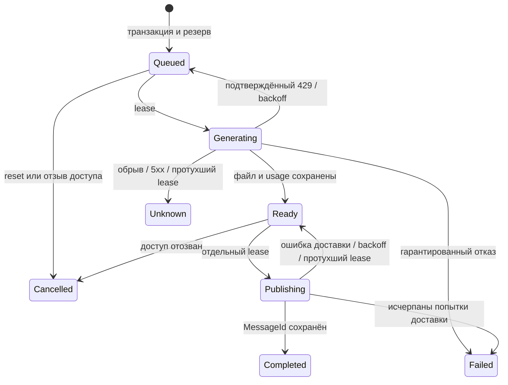

# Архитектура

## Исходное состояние и интеграция

При аудите найдены `.slnx`, один консольный проект `net11.0`, `Program.cs` с `Hello, World!` и настройки IDE. README, AGENTS.md, существующих команд, DI, ORM, БД, очереди, авторизации и деплоя не было. TargetFramework сохранён. Сторонняя функциональность отсутствовала; создавать параллельный самостоятельный Telegram-бот к уже работающему хосту не понадобилось.

Порядок реализации: доменные данные и интерфейсы → SQLite/транзакции/миграции → сессии и лимиты → worker и хранилище → провайдеры → Telegram-маршрутизация → тесты и запуск. По последующему требованию владельца Telegram transport переведён на `Telegram.Bot`, добавлено сохраняемое управление доступом.

Хост подключает модуль через `AddImageGeneration(options, telegramOptions, chatOptions)`, применяет `ImageDatabase.Migrate()` и запускает hosted services. Третий аргумент необязателен. Для существующего Telegram-хоста отключите `Telegram:EnablePolling`, зарегистрируйте его `ITelegramBotClient` **до** регистрации модуля и передавайте Update в `ImageUpdateHandler.HandleAsync(Update, CancellationToken)`. Возвращаемый `false` означает, что обработку могут продолжить другие модули. Не запускайте второй receiver. При конфликте команд маршрутизируйте только `/ai_*` и предназначенные модулю Reply/фото; конфигурации списка команд в BotFather код не меняет.

## Основные сервисы

| Файл / сервис | Ответственность |
| --- | --- |
| `Domain/Models.cs` | Actor, сессии, граф результатов, jobs, usage, provider DTO |
| `Application/Contracts.cs` | Интерфейсы провайдера, файлов, очереди и Telegram gateway |
| `Application/ImageOptions.cs` | Feature flag, параметры, лимиты и валидация |
| `Application/ImageAccessService.cs` | Владелец, разрешения user/chat, отзыв, защита повторов |
| `Application/AccessRequestService.cs` | Заявки пользователей, одна ожидающая заявка на человека, решения владельца и атомарная выдача доступа |
| `Application/AccessRequestWorker.cs` | Персистентная доставка карточки владельцу и результата заявителю, lease и повторы |
| `Application/ImageConversationService.cs` | Один ожидающий шаг на человека/чат, завершение, замена, отмена и TTL |
| `Application/ImageJobService.cs` | Enqueue, точный Reply, reset, изоляция, резервирование, usage |
| `Application/ImageJobWorker.cs` | Lease/heartbeat, восстановление, генерация, публикация и повторы |
| `Application/ImageStatusService.cs` | Один режим прогресса на задачу: native draft или обычный статус; поздние ACK, ошибки и переходы fallback |
| `Application/Texts.cs` | Основные русские сообщения |
| `Infrastructure/ImageDatabase.cs` | SQLite WAL, миграции 1/2/3/4/5/6, атомарные операции |
| `Application/ChatService.cs` | Приём в очередь, контекст по user/chat, потоковые drafts, сохранение ответа перед доставкой |
| `Application/ChatJobWorker.cs` | Параллельная обработка диалогов, FIFO внутри диалога, lease/heartbeat, восстановление и повторы доставки |
| `Infrastructure/OpenAiChatProvider.cs` | Responses API с SSE, накопление текста, проверка завершения без платных повторов |
| `Infrastructure/LocalAssetStore.cs` | UUID storage, лимиты, проверка PNG/JPEG/WebP, EXIF-поворот, нормализация |
| `Infrastructure/OpenAiImageProvider.cs` | Изолированный HttpClient для generations/edits, usage, классификация ошибок |
| `Infrastructure/FakeImageProvider.cs` | Локальная тестовая картинка без сети |
| `Telegram/TelegramGateway.cs` | Отправка и ограниченное скачивание через Telegram.Bot |
| `Telegram/ImageUpdateHandler.cs` | Команды, фото/документы, Reply, callbacks, интеграционный вход |
| `Telegram/TelegramPollingWorker.cs` | GetUpdates через SDK и сохранённый offset |
| `Telegram/TelegramCommandMenu.cs` | Автоматическая регистрация меню, русская локализация и отдельные команды владельца в личке |
| `DependencyInjection.cs` | Регистрация модуля и адаптеров |

Остальные добавленные/изменённые файлы: исходный хост и его `.csproj`, `.slnx`, проект библиотеки, тестовый проект и четыре набора тестов, `appsettings.json`, `.gitignore`, `.dockerignore`, `Directory.Build.props`, `Dockerfile`, `compose.yaml`, README и документы в `docs`.

## Данные и транзакции

Таблицы: `ImageSessions`, `ImageActiveSessions`, `ImageGenerations`, `ImageAssets`, `ImageTelegramMessages`, `ImageJobs`, `ImageUsage`, `ImageDrafts`, `ImageUpdates`, `ImageAccessGrants`, `ImagePromptReplies`, `ImageAccessRequests`, `ImageChats`, `ImageChatRequests`, `ImageSchema`.

`ImageChatRequests` сохраняет запрос до подтверждения Telegram update. Обработчик не ждёт ответа OpenAI. `ChatJobWorker` запускает `Chat.MaxConcurrentRequests` слотов (4 по умолчанию); захват в транзакции дополнительно проверяет общий предел и единственный активный запрос на пару ChatId/UserId. Порядок задаётся сохраняемым Sequence, включая запросы с отложенной доставкой. Контекст читается при начале генерации, после завершения предыдущего вопроса. Другие диалоги не ждут медленный запрос или повтор доставки.

Heartbeat продлевает lease каждые 10 секунд. Истечение lease до отметки начала запроса допускает безопасный запуск; после отметки начала новый вызов модели запрещён. Если ответ сохранён, повторяется доставка с уже записанных MessageIds; иначе сохраняется уведомление о прерывании. Reset меняет версию контекста, отменяет старые задания и позволяет новому запросу начаться без ожидания старой модели. Версия и владелец lease проверяются перед сохранением ответа, обновлением draft и публикацией. Проверки доступа повторяются worker. Фоновые сервисы должны запускаться и при интеграции через webhook.

`ImageAccessRequests` хранит автора/чат личной заявки, профиль для карточки владельца, состояние Pending/Approved/Declined, решение и состояние доставки двух уведомлений. Частичный unique index по UserId для Pending исключает дубли при одновременных запросах. Решение проверяет текущего владельца и его личный чат; Approved и user grant фиксируются в одной транзакции. Повтор старого callback не выдаёт доступ заново. Worker использует lease, backoff и сохранённые признаки доставки. Потеря ответа Telegram после успешной отправки может привести к повторной карточке/уведомлению, но не к повторному изменению разрешений. Профиль пользователя экранируется при HTML-выводе. Список заявок доступен только владельцу в личке.

Для небольшой группы выбран простой SQLite repository: каждая сущность хранится как JSON payload с первичным ключом, используются JSON expression indexes для idempotency/job status/session. Доступ к данным проходит через короткую `BEGIN IMMEDIATE` транзакцию; она загружает агрегаты и сохраняет изменения. Запись в очередь, резерв, проверка квот, reset и смена головы сериализованы в БД. API-вызовы и декодирование изображений выполняются вне транзакции.

Этот подход сознательно ограничен небольшой группой: чтение/обновление проходит по всем сохранённым агрегатам, история и update receipts растут. Для большей нагрузки нужно заменить repository на выборочные SQL-запросы/ORM, добавить нормализованные FK и очистку receipts. Публичные контрактные интерфейсы не зависят от SQLite.

ActiveSession адресуется парой ChatId/UserId. Новые результаты получают новые GUID; ссылки ParentGenerationId/SourceGenerationId сохраняют граф. Reply ищется только по паре ChatId/MessageId из опубликованных сообщений. Для чужой ветки используются только публичный source ID и разрешённый результат. Промпты и другие assets автора в провайдер не передаются. Прямой InputAssetId допускается только для владельца asset в том же чате; Telegram adapter назначает владельца при загрузке.

Reset закрывает сессию, увеличивает версию, очищает указатель и черновик, отменяет ещё не начатые заявки этой сессии с возвратом резерва. Завершение работающего job меняет head только если сессия по-прежнему активна и её версия совпадает с версией enqueue. Результат старого job может быть опубликован как старый результат, но новую активную сессию не подменяет.

## Состояния очереди

Глобальная параллельность ограничена конфигурацией и проверкой leases в БД. Пользовательская параллельность также проверяется глобально по UserId, включая разные чаты; на сессию допускается одна работа. Heartbeat продлевает lease во время внешней операции. Несколько worker не могут одновременно захватить один job. Для Telegram polling требуется один процесс на токен.

Продолжение незавершённого результата без явного нового источника отклоняется сообщением «предыдущий запрос выполняется». Это исключает незаметное редактирование устаревшего head. Явные новые сессии и ветки могут ждать в очереди.

## Деньги, отказы и ограничения

По последующему требованию владельца `ImageGeneration.LimitsEnabled` по умолчанию выключен: дневные/месячные квоты, бюджетные отказы и ограничение длины очереди не применяются. Учёт usage и ориентировочной стоимости продолжается. Описанные проверки квот включаются только при явном `LimitsEnabled=true`. Ограничения декодирования файлов, рабочая параллельность, контроль доступа и корректность последовательного редактирования остаются техническими условиями обработки.

- Images API вызывается напрямую из одного адаптера через HttpClient, без автоматического retry handler. `safety_identifier` — HMAC UserId с серверной солью. CorrelationId не считается провайдерной идемпотентностью.
- 429 повторяется ограниченно; 401/400/модерация — без повторов. 5xx консервативно считается неопределённым, поскольку работа могла начаться. Это сознательно строже рекомендации повторять временные 5xx из ТЗ и исключает риск двойной оплаты без провайдерной идемпотентности.
- Падение между получением ответа OpenAI и фиксацией Ready оставляет Unknown. Автоматического восстановления оплаченного ответа нет; ручная сверка с биллингом обязательна перед повторным запросом/снятием резерва. Восстановление истёкших leases пока видно через БД и сохранённый резерв, отдельного интерфейса оператора нет.
- Сохранение файла и SQLite commit не являются распределённой транзакцией: после падения возможен orphan-файл. Cleanup — P1. Файлы не выдаются по произвольному пути или внешнему URL.
- Telegram не предоставляет sendPhoto idempotency key. Если сообщение отправлено, но ответ/commit потерян, повтор публикации может дать дубликат сообщения. Нового вызова OpenAI при этом нет.
- После исчерпания попыток доставки job имеет Failed/telegram_delivery; asset и оплаченный usage сохраняются. Автоматического бесконечного повтора нет; команда ручной повторной доставки — дальнейшее улучшение.
- Резерв USD — оценка, которую владелец задаёт консервативно. Фактическая стоимость может быть выше; локальная система не обещает жёсткий предел внешнего списания. Все расчёты /usage остаются локальной оценкой даже при получении токенов. Ставки не заданы по умолчанию и не подменяются выдуманным тарифом.
- Набор разрешённых quality/size в MVP намеренно узкий: low/medium/high/xhigh/max и 1024x1024/1536x1024/1024x1536. DefaultModel конфигурируемый; выбор пользователем и HighQualityModel — P1. Автоматической проверки доступа аккаунта и fallback после недоступной модели нет: такой запрос завершится отказом без повторного платного вызова.
- Коллекции референсов предусмотрены в данных и provider API; Telegram P0 принимает один файл и явно отклоняет альбомы. Добавление референсов к черновику — P1.
- Срок доступности файла проверяется, физический retention, история/настройки, удаление пользователем и reroll — P1. Кнопки «Продолжить» и «Оригинал» реализованы с проверкой доступа. Удаление сообщения в Telegram не является сигналом к удалению файла.
- Секреты, изображения, base64, полные промпты, URL с токеном и сырые ошибки API не логируются. HttpClient Telegram создан без стандартного DI URL-логирования, retry SDK отключён в пользу политики worker.
- Нативное декодирование SkiaSharp ограничивается байтами и пикселями до выделения bitmap; PNG нормализация удаляет метаданные. CancellationToken ограничивает I/O, но не прерывает синхронный нативный decode посередине. Для враждебного публичного ввода нужна дополнительная процессная изоляция; бот предназначен для разрешённых пользователей.

## Документация API

Проверены 17.11.2026: [Image Generation](https://developers.openai.com/api/docs/guides/image-generation), [Image Edits](https://developers.openai.com/api/reference/resources/images/methods/edit), [Flare](https://developers.openai.com/api/docs/models/gpt-image-2.6-flare), [Sunburst](https://developers.openai.com/api/docs/models/gpt-image-2.6-sunburst), [Pricing](https://developers.openai.com/api/docs/pricing), [Telegram Bot API](https://core.telegram.org/bots/api), [Telegram.Bot](https://telegrambots.github.io/book/).

Модели из ТЗ существуют в публичной документации; доступность для конкретного API-аккаунта не проверена. Приложение не перечисляет модели и не выполняет платный smoke test при старте. Версии SDK и пакетов закреплены в `.csproj`.
